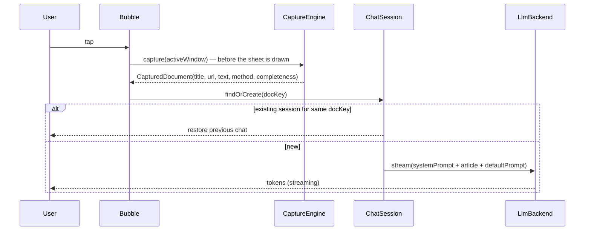
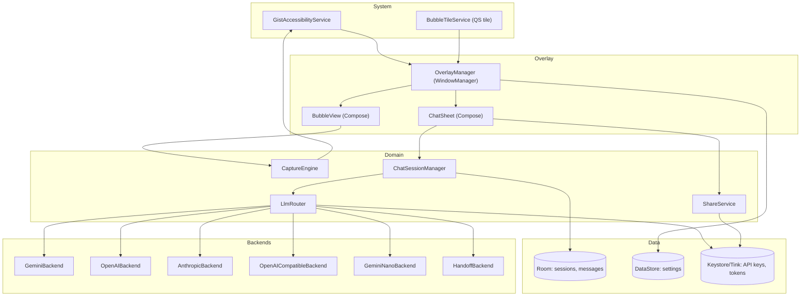
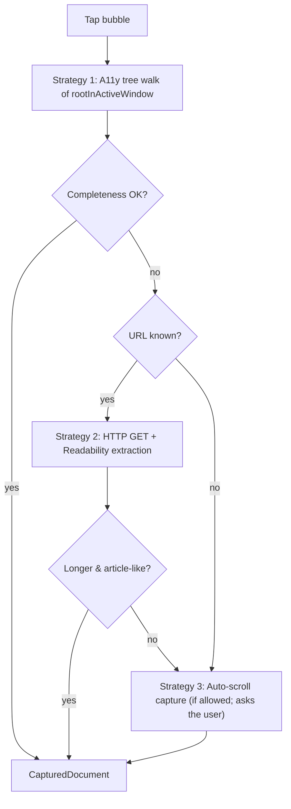
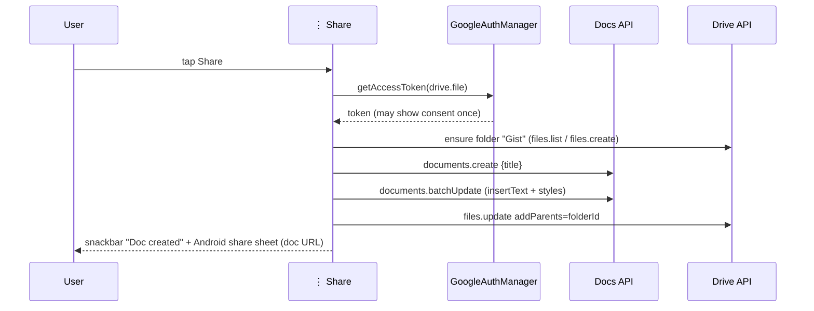
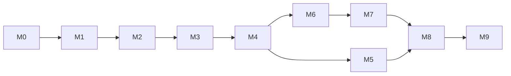

# Screen Summarizer (working title: "Gist") — Design Specification & Implementation Plan

| | |
|---|---|
| **Status** | Draft v1 (agreed via design interview) |
| **Platform** | Android, minSdk 31 (Android 12), target/compile = latest SDK; optimized for current Pixels |
| **Distribution** | Sideload / personal use first; code kept Play-policy-compliant so publishing stays possible |
| **Language / UI** | Kotlin 2.x, Jetpack Compose, Material 3 (Expressive) |

---

## 1. Problem & Goals

Long-form news and analysis pieces are valuable but slow to read. Sharing links to ChatGPT/Claude/Gemini used to be a fast way to get a summary, but that is now often behind a paywall or blocked. **Gist** puts an LLM right on top of whatever the user is reading:

1. **Capture** the article text from the current screen, *including content scrolled off-screen*.
2. **Chat** about it in a minimal floating chat box (summary, extraction, Q&A, follow-up web research).
3. **Share** the result as a Google Doc.

### Goals
- G1: One tap from "reading an article" to "seeing a summary" (target < 3 s to first token with a cloud backend).
- G2: Minimal UI that keeps the article visible.
- G3: Bring-your-own LLM access; no app backend server, no telemetry.
- G4: Safe handling of sensitive screen content.

### Non-goals (v1)
- Hosting or proxying LLM calls through our own server.
- Automating ChatGPT/Claude/Gemini **consumer web UIs** (breaks ToS and is fragile; explicitly rejected).
- Long-running "Deep Research" reports.
- Image/video understanding (text only).
- Cross-device sync.

---

## 2. Key Decisions (from the interview)

| # | Topic | Decision |
|---|---|---|
| D1 | LLM access | **Pluggable backends**: (a) BYO API key: Gemini, OpenAI, Anthropic, OpenRouter/OpenAI-compatible; (b) **on-device Gemini Nano** (AICore / ML Kit GenAI) where available; (c) **hand-off** to the official ChatGPT / Claude / Gemini apps, which uses the user's subscription. Consumer subscriptions do **not** include API access, so this is the only compliant way to use them. |
| D2 | Text capture | **Hybrid**: AccessibilityService node-tree dump → if truncated, **URL fetch + Readability** extraction → last resort, **auto-scroll capture**. |
| D3 | Distribution | Sideload first; Play-compliant code paths (prominent disclosure, no hidden data collection). |
| D4 | Overlay tech | WindowManager overlay of type `TYPE_ACCESSIBILITY_OVERLAY`, hosted by the AccessibilityService, rendered with Compose. No `SYSTEM_ALERT_WINDOW`. |
| D5 | Tap behavior | Tap bubble → capture immediately → show "captured" chip → **auto-run a configurable default prompt**. |
| D6 | Share | Google Sign-In + **Docs API (`drive.file` scope)** → formatted doc → Android share sheet with the link. Default content: the whole chat, with the source link at the top. |
| D7 | Web research | Provider-native web search tools behind a 🌐 toggle (off by default), with citations rendered as links. |
| D8 | Persistence | Local Room history, Keystore-encrypted keys, auto-delete after N days, no telemetry. App denylist, and the bubble is hidden on `FLAG_SECURE` screens. |
| D9 | Stack | minSdk 31, Compose, Hilt, Coroutines/Flow, Ktor + kotlinx.serialization (direct REST/SSE), Room, DataStore; single `:app` module with strict package layering. |
| D10 | Chat layout | Bottom half-sheet (55% → 90% draggable), translucent scrim, streaming Markdown, header with ⋮ menu at top-right. |
| D11 | Bubble visibility | Visible only in **allowlisted reading apps** (editable), plus a **Quick Settings tile** to show it anywhere. |

---

## 3. User Experience

### 3.1 First run (onboarding)
1. **Welcome**: what the app does, with a privacy statement (prominent disclosure: "Gist reads on-screen text only when you tap the bubble and sends it to the AI provider you choose").
2. **Enable accessibility service**: deep link to `Settings.ACTION_ACCESSIBILITY_SETTINGS`, with an illustrated guide. On Android 13+ sideloaded apps, also explain how to "Allow restricted settings" (App info → ⋮ → Allow restricted settings).
3. **Choose a backend**: on-device (if Nano is available) / paste an API key / "Use my ChatGPT/Claude/Gemini app" (hand-off only).
4. **Optional**: sign in with Google (needed only for Share → Google Doc).
5. Done → the bubble appears the next time an allowlisted app is in the foreground. A "Try it" button opens a sample article in Chrome.

### 3.2 Bubble
- 56 dp circular FAB-like bubble with the app glyph; 85% opacity when idle.
- **Drag** anywhere; on release it **snaps to the nearest horizontal edge** (spring animation) and its vertical position is saved.
- **Long-press + drag** reveals a bottom "✕" dismiss target; dropping it there hides the bubble until the next app switch (or permanently for this app, via a snackbar action).
- **States**: idle · capturing (progress ring) · streaming (pulsing dot badge) · error (red dot).
- Visibility rules (D11): shown if the foreground package is in the allowlist **or** the QS tile is ON; hidden if the package is denylisted, the window is `FLAG_SECURE`, the keyboard is up over a password field, or the device is locked.

### 3.3 Chat box (bottom half-sheet)
```
┌────────────────────────────────────────────────────────┐
│ 📰 "Why the Fed…" · 4,210 words  ↻      [Gemini ▾] ⋮ — │  ← header
├────────────────────────────────────────────────────────┤
│  ▸ TL;DR                                               │
│    • …                                                 │  ← streaming Markdown
│  ▸ Key points                                          │
│    1. …   [¹]                                          │
│                                                        │
│  [Key facts] [ELI5] [Counter-arguments] [Timeline]     │  ← quick-action chips
├────────────────────────────────────────────────────────┤
│ 🌐  Ask about this article…                    ➤ / ■   │  ← composer
└────────────────────────────────────────────────────────┘
```
- **Height**: opens at ~55% of the screen, can be dragged to 90% or dragged down to dismiss (collapses back to the bubble). Above the sheet, a 20% black scrim keeps the article visible; tapping the scrim collapses the sheet.
- **Header**:
  - *Source chip*: page title + word count; tap to preview the captured text (lets the user verify the capture), long-press to copy.
  - *↻ Re-capture*: re-runs the capture pipeline and starts a new context (asks "Keep chat?").
  - *Backend pill*: quick switch of backend/model (e.g. "Nano", "Gemini Flash", "Claude", "→ ChatGPT app").
  - *⋮ menu* (Material `DropdownMenu`, anchored top-right):
    - **Share** — icon: forked arrow (`Icons.Outlined.Share`)
    - **Settings** — icon: gear (`Icons.Outlined.Settings`)
    - *(also)* Copy last answer · Open in ChatGPT/Claude/Gemini app · New chat
  - *— Minimize*: collapses to the bubble without losing state; streaming continues in the background.
- **Messages**: streaming Markdown (headings, lists, bold, links, tables), citation superscripts linking to the source; long-press a message → Copy / Share / Regenerate.
- **Composer**: single-line field that grows to 5 lines; 🌐 toggle (D7, disabled with a tooltip on Nano); Send turns into Stop while streaming.
- **Keyboard**: the overlay window uses `FLAG_NOT_TOUCH_MODAL` and toggles `FLAG_NOT_FOCUSABLE` off only while the composer is focused, so typing works without stealing focus from the underlying app otherwise. Handles IME insets (`WindowInsets.ime`).

### 3.4 Tap flow (D5)


### 3.5 Hand-off mode (subscription use)
When the selected backend is "ChatGPT app" / "Claude app" / "Gemini app":
- Tapping the bubble captures the text, then shows a compact card: *"Send to ChatGPT with prompt: [Summarize ▾]"* → `Intent.ACTION_SEND` (`text/plain`) targeted at the package (`com.openai.chatgpt`, `com.anthropic.claude`, `com.google.android.apps.bard`). The text is prompt + source URL + article (trimmed to ~100 KB to stay well under the Binder limit).
- If the target app isn't installed → fall back to the system share chooser.
- Chat then happens in the official app; Gist's chat box is not used. This is documented as a limitation.

### 3.6 Settings (full-screen activity)
Opened from ⋮ → Settings (launches `SettingsActivity` with `FLAG_ACTIVITY_NEW_TASK`; the sheet collapses).

| Section | Items |
|---|---|
| **AI backend** | Default backend; per provider: API key (masked, "Test" button), model picker (fetched from the provider's `models` endpoint, cached), temperature, max output tokens; OpenAI-compatible base URL; on-device Nano status/download; hand-off target app |
| **Prompts** | Default auto-run prompt (editable; templates: TL;DR+Key points, Bullet facts, Neutral brief); system prompt; quick-action chips (add/edit/reorder); response language (auto / fixed); length (short/medium/long) |
| **Capture** | Strategy order (Accessibility → URL fetch → Auto-scroll); "Allow auto-scroll" toggle; max article length; show capture preview before sending |
| **Bubble** | App allowlist (editable, with defaults); denylist; size; opacity; auto-hide while keyboard is open; Quick Settings tile help |
| **Web research** | Default 🌐 state; max searches per turn |
| **Share** | Google account (sign in/out); doc contents (whole chat / last answer); Drive folder name ("Gist"); include captured article text (off) |
| **History & privacy** | History on/off; retention (1/7/30/90 days, forever); clear all; view history list; "Send article text to cloud" confirmation for first use per provider |
| **About** | Version, licenses, privacy policy, accessibility-service disclosure |

---

## 4. Architecture

### 4.1 Component overview


### 4.2 Package layout (single `:app` module)
```
com.gist.app
├── GistApp.kt                     // @HiltAndroidApp
├── a11y/                          // GistAccessibilityService, ForegroundAppTracker, SecureWindowDetector
├── overlay/                       // OverlayManager, OverlayLifecycleOwner, BubbleWindow, ChatSheetWindow
│   └── ui/                        // Bubble.kt, ChatSheet.kt, MessageList.kt, Composer.kt, HeaderMenu.kt
├── capture/                       // CaptureEngine, strategies/, Readability, TextCleaner, Completeness
├── llm/
│   ├── LlmBackend.kt              // interface + models (ChatRequest, ChatEvent, Citation)
│   ├── LlmRouter.kt
│   ├── gemini/ openai/ anthropic/ compat/ nano/ handoff/
│   └── sse/                       // shared SSE parser over Ktor
├── chat/                          // ChatSessionManager, PromptBuilder, ContextBudgeter
├── share/                         // GoogleAuthManager, DocsExporter, MarkdownToDocsConverter
├── settings/                      // SettingsActivity, screens/, SettingsRepository
├── onboarding/                    // OnboardingActivity
├── data/                          // Room db, DAOs, entities, SecureStore
├── qs/                            // BubbleTileService
└── di/                            // Hilt modules
```
Layering rule: `ui → domain (chat/capture/share) → data/llm`. No Android framework types in `llm/` or `chat/` except through interfaces, so they stay unit-testable.

### 4.3 Hosting Compose in an overlay
Compose needs a `LifecycleOwner`, `ViewModelStoreOwner` and `SavedStateRegistryOwner`. `OverlayLifecycleOwner` implements all three, gets attached to each `ComposeView` via `setViewTreeLifecycleOwner(...)` etc., and is driven by the service lifecycle (`onServiceConnected` → RESUMED, `onUnbind` → DESTROYED). Two windows:
- **Bubble window**: `WRAP_CONTENT`, `FLAG_NOT_FOCUSABLE | FLAG_LAYOUT_NO_LIMITS`, position updated on drag.
- **Sheet window**: `MATCH_PARENT`, created lazily, `FLAG_NOT_TOUCH_MODAL`; focusable only while composing.

---

## 5. Text Capture (D2)

### 5.1 Data model
```kotlin
data class CapturedDocument(
    val sourcePackage: String,
    val title: String?,
    val url: String?,
    val text: String,              // cleaned, paragraph-separated
    val wordCount: Int,
    val method: CaptureMethod,     // A11Y_TREE, URL_FETCH, AUTO_SCROLL, SHARED_TEXT
    val completeness: Completeness,// LIKELY_COMPLETE, LIKELY_TRUNCATED, UNKNOWN
    val capturedAt: Instant,
) { val docKey: String get() = url?.normalizeUrl() ?: "$sourcePackage:${title.orEmpty().hashCode()}" }
```

### 5.2 Pipeline


**Strategy 1 — Accessibility tree**
- Service config: `canRetrieveWindowContent=true`, `flagReportViewIds`, `flagRetrieveInteractiveWindows`, `flagIncludeNotImportantViews`, event types `TYPE_WINDOW_STATE_CHANGED | TYPE_WINDOWS_CHANGED`. No continuous text-event listening (privacy and battery): content is read **only on tap**.
- Iterative DFS over `AccessibilityNodeInfo`, collecting `text` / `contentDescription`, skipping our own windows, buttons/nav chrome (heuristics: `className` Button/ImageButton, very short texts repeated across siblings, `isClickable && text.length < 25`).
- In Chrome/WebViews the tree usually contains **the full DOM text including off-screen parts**. Group text by `WebView` subtree and pick the largest text-dense subtree as the article body (simple Readability-like scoring: text length × paragraph count ÷ link density).
- **URL discovery**: Chrome's `com.android.chrome:id/url_bar` text; Firefox `org.mozilla.firefox:id/mozac_browser_toolbar_url_view`; plus generic: first node whose text matches a URL regex in the top 15% of the screen. Normalize (add `https://`, strip tracking params `utm_*`, `fbclid`).
- **Completeness heuristic** → `LIKELY_TRUNCATED` if: words < 300 while a scrollable container exists that `canScrollForward`; or the last paragraph ends without terminal punctuation; or text ≈ the visible-only text (sum of nodes with `isVisibleToUser`).

**Strategy 2 — URL fetch + Readability**
- Ktor GET with a mobile Chrome UA, cookies off, 10 s timeout, 5 MB cap. Parse with **jsoup**; extract with a Kotlin port of Mozilla Readability (or `net.dankito.readability4j`). Also try JSON-LD `articleBody` and `<meta property="og:title">`.
- Accept if extracted words > 1.2× the a11y words and > 250 words. Paywalled pages typically return a teaser → falls through to strategy 3.

**Strategy 3 — Auto-scroll capture**
- Shown as a prompt: *"Only part of the article is visible. Scroll through it automatically? (≈10 s)"*.
- Find the main scrollable node; loop: collect visible text → `performAction(ACTION_SCROLL_FORWARD)` (fallback: `dispatchGesture` swipe) → wait for `TYPE_VIEW_SCROLLED` or 400 ms → stop when the new text overlap is > 90% or after 60 pages / 30 s. Deduplicate with line-level hashing (rolling-window merge). Then scroll back (`ACTION_SCROLL_BACKWARD` ×N) to restore the position. The bubble shows a progress ring and a Cancel button.

**Other input paths (cheap wins)**
- Gist registers as an `ACTION_SEND` target (`text/plain`), so a "Share → Gist" from any app opens the chat sheet with the shared URL/text (strategy 2 on URLs).
- `ACTION_PROCESS_TEXT`: select text → "Ask Gist".

### 5.3 Cleaning
Collapse whitespace, drop duplicates, remove boilerplate lines (cookie banners, "Subscribe", "Share this", "Advertisement", related-article lists via link-density), keep paragraph breaks. Cap the final text at the configured max (default 60k words).

---

## 6. LLM Layer (D1, D7)

### 6.1 Interface
```kotlin
interface LlmBackend {
    val id: BackendId
    val capabilities: Capabilities   // streaming, webSearch, maxContextTokens, onDevice, inAppChat
    suspend fun isAvailable(): Availability
    fun stream(request: ChatRequest): Flow<ChatEvent>
}
data class ChatRequest(val system: String, val messages: List<ChatMessage>, val model: String,
                       val webSearch: Boolean, val temperature: Float?, val maxOutputTokens: Int?)
sealed interface ChatEvent {
    data class Delta(val text: String) : ChatEvent
    data class Citations(val items: List<Citation>) : ChatEvent
    data class Usage(val inputTokens: Int, val outputTokens: Int) : ChatEvent
    data class Error(val kind: ErrorKind, val message: String) : ChatEvent
    data object Done : ChatEvent
}
```

### 6.2 Backends
| Backend | Transport | Streaming | Web search (🌐) | Notes |
|---|---|---|---|---|
| **Gemini API** | REST `models/{m}:streamGenerateContent?alt=sse`, header `x-goog-api-key` | SSE | `tools: [{google_search: {}}]` → `groundingMetadata` → citations | Long context; good default for long articles |
| **OpenAI** | Responses API `POST /v1/responses`, `stream: true` | SSE | `tools: [{type: "web_search"}]` → `url_citation` annotations | |
| **Anthropic** | `POST /v1/messages`, `stream: true`, `anthropic-version` header | SSE | server tool `web_search` → `web_search_result_location` citations | Use prompt caching (`cache_control`) on the article block to make follow-ups cheaper |
| **OpenAI-compatible** | Chat Completions at a custom base URL (OpenRouter, local Ollama, etc.) | SSE | not supported (toggle disabled) | |
| **Gemini Nano** | ML Kit GenAI Prompt API / AICore | Flow | not supported → optional "Use cloud for web" fallback | Small context: article is map-reduce summarized (§6.4); availability checked at runtime and model download triggered from Settings |
| **Hand-off** | `Intent.ACTION_SEND` to the official app | — | — | `inAppChat=false`; uses the user's subscription |

Model IDs are **never hard-coded in UI logic**: defaults come from a small `defaults.json` asset and the picker refreshes from each provider's list-models endpoint. (Exact current model names are verified at implementation time.)

### 6.3 Prompting
- **System prompt** (editable): *"You are a reading assistant. The user is reading the article below. Answer using the article first; say when something is not in the article. Be concise, use Markdown headings and bullets. If web search is enabled, cite sources."*
- The article is injected once as a delimited block: `<article title=… url=… captured_via=…>…</article>`, then the conversation follows.
- Default auto-run prompt: *"Give a TL;DR (2 sentences), then 5–7 key points, then notable numbers/quotes, then what's missing or debatable."*
- Response language: matches the user's locale unless configured otherwise.

### 6.4 Context budgeting
`ContextBudgeter` estimates tokens (≈ chars/4; per-provider count endpoint optional).
- If article + history fit in 70% of the model's context → send as is.
- Otherwise → **map-reduce**: chunk by paragraphs (~3k tokens), summarize the chunks in parallel (max 4 concurrent), then answer over the combined chunk summaries. This is always used for Nano.
- Long chats: keep the article + last N turns + a rolling summary of older turns.

### 6.5 Errors
Typed `ErrorKind`: `AUTH` (invalid key → link to Settings), `RATE_LIMIT` (retry with backoff, show countdown), `CONTEXT_TOO_LONG` (auto map-reduce), `NETWORK` (retry button), `SAFETY_BLOCKED`, `UNAVAILABLE` (Nano not downloaded). Shown inline as an error bubble with an action.

---

## 7. Share → Google Doc (D6)

### 7.1 Auth
- Credential Manager "Sign in with Google" for identity, then `Identity.getAuthorizationClient(ctx).authorize(...)` requesting **`https://www.googleapis.com/auth/drive.file`** only (non-sensitive scope → no Google verification needed for personal use).
- The authorization `PendingIntent` must be launched from an Activity → a transparent `AuthTrampolineActivity` is started from the overlay.
- Access tokens are short-lived and re-requested silently; nothing long-lived is stored except the account email (DataStore).
- Setup: Google Cloud project → enable the Docs API + Drive API → OAuth client (Android) with package name + SHA-1 of the debug and release keys.

### 7.2 Export flow

- **Doc structure**: Title = `Gist: <article title>`; header lines: source URL (linked), captured date, backend/model; then, for each turn: "**You:** …" / answer converted from Markdown → Docs requests (`HEADING_1..3`, bullets via `createParagraphBullets`, bold/italic/link `updateTextStyle`); citations as a "Sources" list at the end. Optional appendix: the captured article text (off by default).
- `MarkdownToDocsConverter` parses with **commonmark-java** and emits `batchUpdate` requests, computing UTF-16 indexes (the Docs API uses UTF-16 code-unit offsets).
- Offline/failure → offer a fallback "Share as text" (Markdown) through the share sheet.

---

## 8. Data, Security & Privacy (D8)

### 8.1 Storage
- **Room**:
  - `SessionEntity(id, docKey, title, url, sourcePackage, captureMethod, articleText, backendId, model, createdAt, updatedAt)`
  - `MessageEntity(id, sessionId, role, content, citationsJson, createdAt, tokenUsage)`
- **DataStore (Proto or Preferences)**: all settings, allowlist/denylist, bubble position.
- **Secrets**: API keys encrypted with **Tink AEAD**, using a key stored in the Android Keystore (`AndroidKeysetManager`); never logged, `android:allowBackup` excludes them (`dataExtractionRules`).
- **Retention**: `WorkManager` periodic job (daily) deletes sessions older than N days.

### 8.2 Privacy guards
- Capture happens **only on an explicit tap** (or share/process-text intent); the service never streams screen text in the background.
- **Default denylist**: banking (heuristic categories + curated list), password managers, the system Settings app, SMS/messaging apps, authenticator apps, and Gist itself.
- **FLAG_SECURE**: when the active window is secure (detected via `AccessibilityWindowInfo` / empty or blocked content), the bubble hides.
- Password fields (`isPassword`) are always skipped by the tree walker.
- First cloud use per provider shows a one-time confirmation: "Article text will be sent to <Provider>".
- No analytics, no crash reporting by default (optional opt-in local crash log export).

### 8.3 Permissions
| Permission | Why |
|---|---|
| Accessibility service binding (`BIND_ACCESSIBILITY_SERVICE`) | Read screen text on tap, draw the overlay, auto-scroll |
| `INTERNET` | LLM + Docs APIs, URL fetch |
| `POST_NOTIFICATIONS` (optional) | Error/status notifications only |
| `QUERY_ALL_PACKAGES` — **avoided**; instead `<queries>` for the hand-off packages and browsers | App picker for the allowlist uses launcher-intent queries |

No `SYSTEM_ALERT_WINDOW`, no `FOREGROUND_SERVICE` needed (the accessibility service keeps the process alive).

---

## 9. Tech Stack & Build

| Area | Choice |
|---|---|
| Build | Gradle wrapper upgraded from 8.7 to the version current AGP needs; version catalog (`libs.versions.toml`); Kotlin 2.x + Compose compiler plugin; KSP |
| UI | Compose BOM, Material 3 (Expressive), Navigation Compose (Settings/Onboarding), `compose-markdown` renderer (e.g. `mikepenz/multiplatform-markdown-renderer`) |
| DI | Hilt (`@AndroidEntryPoint` on the service via `EntryPointAccessors` where needed) |
| Async | Coroutines, Flow; `SupervisorJob` scope tied to the service |
| Network | Ktor client (OkHttp engine) + kotlinx.serialization; custom SSE parser |
| HTML | jsoup + Readability4J |
| Markdown → Docs | commonmark-java |
| Persistence | Room, DataStore, Tink |
| Auth | Credential Manager + `play-services-auth` AuthorizationClient |
| On-device | ML Kit GenAI (Prompt/Summarization APIs) / AICore |
| Background | WorkManager (retention) |
| Testing | JUnit5/Kotest, Turbine (Flow), MockWebServer/Ktor MockEngine, Robolectric, Compose UI tests, UiAutomator for overlay/a11y E2E |
| Quality | ktlint/detekt, Android Lint, R8 full mode, Baseline Profiles |

---

## 10. Implementation Plan

Each milestone ends with a demo on a physical Pixel. Estimated effort assumes one developer.

### M0 — Project skeleton (0.5–1 day)
- [ ] Upgrade the Gradle wrapper; create the `:app` module, version catalog, Hilt, Compose, detekt/ktlint, CI (GitHub Actions: build + unit tests).
- [ ] App theme (Material 3, dynamic color), `GistApp`, empty `OnboardingActivity`, `SettingsActivity`.
- **Exit**: `./gradlew assembleDebug` installs and launches.

### M1 — Accessibility service + bubble overlay (2–3 days)
- [ ] `GistAccessibilityService` + `accessibility_service_config.xml`; onboarding step to enable it (+ restricted-settings guidance).
- [ ] `OverlayLifecycleOwner`, `OverlayManager`, Compose `Bubble` with drag, edge snap, dismiss target, saved position.
- [ ] `ForegroundAppTracker` (from `TYPE_WINDOW_STATE_CHANGED`) + allowlist/denylist visibility rules; `BubbleTileService` QS tile.
- **Exit**: the bubble appears in Chrome only, drags smoothly, and the QS tile forces it on elsewhere.

### M2 — Chat sheet UI with a fake backend (2–3 days)
- [ ] `ChatSheet` (half-sheet, drag to 90%, scrim, minimize), header (source chip, re-capture, backend pill, ⋮ menu with **Share** [forked arrow] and **Settings** [gear]), message list with streaming Markdown, composer with 🌐 toggle + Send/Stop, quick chips.
- [ ] IME handling and focus toggling of the overlay window.
- [ ] `FakeBackend` emitting lorem tokens.
- **Exit**: full UI flow works end-to-end with fake data.

### M3 — Capture engine (3–4 days)
- [ ] Strategy 1: tree walker, article-subtree scoring, URL discovery, cleaning, completeness heuristic.
- [ ] Strategy 2: Ktor fetch + jsoup + Readability4J + JSON-LD.
- [ ] Strategy 3: auto-scroll with dedupe and position restore; consent prompt; cancel.
- [ ] Capture preview (tap the source chip); `ACTION_SEND` + `PROCESS_TEXT` entry points.
- [ ] Test corpus: 20 saved pages (NYT, FT, Guardian, Substack, Medium, Reuters, Ars, Bloomberg app, Google News app) with golden word counts.
- **Exit**: ≥ 90% of the corpus captured as `LIKELY_COMPLETE` with ≥ 95% of the article words.

### M4 — LLM layer: cloud backends (3–4 days)
- [ ] `LlmBackend`, `LlmRouter`, shared SSE parser, `ChatSessionManager`, `PromptBuilder`, `ContextBudgeter` (+ map-reduce).
- [ ] Gemini, OpenAI (Responses), Anthropic (Messages + prompt caching), OpenAI-compatible.
- [ ] Web search tool wiring + citation normalization → `Citation(title, url)`.
- [ ] Settings: API key entry with Tink storage, "Test connection", model picker from list-models.
- [ ] Typed errors + inline error UI.
- **Exit**: one-tap summary on a real article with each provider; 🌐 follow-up returns cited answers.

### M5 — On-device Nano + hand-off (2 days)
- [ ] `GeminiNanoBackend`: availability check, download progress in Settings, map-reduce path.
- [ ] `HandoffBackend`: targeted `ACTION_SEND`, compact hand-off card, `<queries>` declarations, chooser fallback.
- **Exit**: summaries work offline on a supported Pixel; hand-off opens ChatGPT/Claude/Gemini with the prompt + article pre-filled.

### M6 — Persistence & privacy (2 days)
- [ ] Room schema, session resume by `docKey`, History screen (list, open, delete).
- [ ] Retention worker; backup exclusions; default denylist; FLAG_SECURE / password-field guards; first-use cloud consent dialog.
- **Exit**: reopening the bubble on the same article restores the chat; data is deleted after the retention period.

### M7 — Share → Google Doc (2–3 days)
- [ ] GCP project + OAuth client (debug/release SHA-1); `GoogleAuthManager` with `AuthTrampolineActivity`.
- [ ] `MarkdownToDocsConverter` (UTF-16 index math, headings, bullets, links, bold/italic); `DocsExporter` with the "Gist" folder.
- [ ] Share sheet with the doc URL; text fallback.
- **Exit**: ⋮ → Share produces a nicely formatted Google Doc in ≤ 5 s and opens the share sheet.

### M8 — Settings completeness & onboarding polish (2 days)
- [ ] All Settings sections from §3.6; prompt/chip editor; app picker for the allowlist/denylist.
- [ ] Onboarding with the prominent disclosure, backend choice, optional Google sign-in, "Try it".
- **Exit**: a new user goes from install to first summary in < 2 minutes without help.

### M9 — Hardening & release (2–3 days)
- [ ] Unit tests (capture heuristics, SSE parsing, budgeter, Markdown→Docs), Robolectric tests for repositories, UiAutomator E2E (Chrome → tap bubble → summary).
- [ ] Performance: Baseline Profile; bubble drag at 120 fps; capture < 300 ms for Strategy 1 on a 5k-word page.
- [ ] Accessibility of our own UI (TalkBack labels, touch targets ≥ 48 dp, large font).
- [ ] Signed release APK on GitHub Releases; README with setup (restricted settings, API keys, OAuth).
- **Exit**: v1.0 sideloadable release.

**Total ≈ 21–27 developer-days.**



---

## 11. Testing Strategy
| Level | What |
|---|---|
| Unit | Tree-walk scoring on serialized node fixtures; Readability extraction on saved HTML; completeness heuristic; SSE parser (chunk boundaries, multi-line `data:`); each backend's request/response mapping (Ktor MockEngine); ContextBudgeter; MarkdownToDocs index math (emoji, CJK) |
| Integration | Room DAOs; Tink SecureStore; DocsExporter against a recorded HTTP fixture |
| UI | Compose tests for ChatSheet states (empty, streaming, error, citations), ⋮ menu items and icons |
| E2E (device) | UiAutomator: open a test article in Chrome → bubble visible → tap → summary streams; denylisted app → no bubble; auto-scroll on a native list app |
| Manual matrix | Pixel (latest), one Samsung, one foldable; light/dark; gesture vs 3-button nav; font scale 200% |

---

## 12. Risks & Mitigations
| Risk | Impact | Mitigation |
|---|---|---|
| Sideloaded apps blocked from accessibility ("restricted settings") on Android 13+ | Onboarding friction | Clear step-by-step guide with screenshots; detect and deep-link to App info |
| Native news apps expose only the visible text | Truncated summaries | URL fetch fallback; auto-scroll; share-to-Gist path |
| Paywalled pages: URL fetch returns a teaser | Truncated summaries | Prefer the a11y/auto-scroll text (it's what the user legitimately sees); completeness chip warns the user |
| Users expect to use their ChatGPT/Claude/Gemini *subscription* in-app | Expectation gap | Hand-off mode + clear copy in onboarding; Nano as a free in-app option |
| Provider API changes (model names, tool schemas) | Breakage | Model lists fetched at runtime; backends isolated behind an interface; contract tests with recorded fixtures |
| Play policy on AccessibilityService | Cannot publish as-is | Sideload v1; keep the disclosure UI and tap-only capture; revisit with a Play declaration or a share-intent-only "Play flavor" |
| Overlay/keyboard focus quirks across OEMs | Typing issues | Focus toggle strategy; device matrix testing |
| Token cost on very long articles | User spend | Map-reduce, Anthropic prompt caching, show token usage per answer, configurable max length |

---

## 13. Open Questions (for later)
1. Product name and icon ("Gist" is a placeholder).
2. Should a "Play flavor" exist that drops accessibility entirely (share-intent + URL fetch only)?
3. Voice input in the composer (on-device speech recognition)?
4. Per-article "highlights" export (quotes with anchors) in the Google Doc?
5. Foldable/tablet layout: side panel instead of a bottom sheet?
